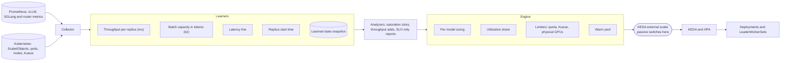

# llm-d-scaling-manager

[](LICENSE)
[](https://github.com/llm-d-incubation/llm-d-scaling-manager/actions/workflows/ci-pr-checks.yaml)
[](go.mod)

llm-d-scaling-manager sizes LLM inference fleets on llm-d, aggregated and
prefill/decode alike. It learns each model's capacity from its own servers
(throughput per replica, batch capacity, latency, start time) and orders the
replicas the load needs. Under a GPU quota it shares the GPUs between models
(**utilization share**, experimental: benchmarked with two models so far; see
[Why use it](docs/why.md#how-mature-each-part-is)): each model gets its need,
the spare goes by weight, and GPUs move as demand shifts. It can run
**passive** first and report what it would do without changing anything.
KEDA does the scaling.



Every 15 seconds it reads the metrics, updates what it has learned, works out
each model's need, fits it into the budget, and answers KEDA. In passive mode
the scaler answers with the current replica count, so nothing moves.
[How it fits together](docs/concepts/architecture.md).

## Start here

- **[The main path: share GPUs between models](docs/well-lit-paths/utilization-share/)**:
  install passive, watch, turn on sharing in shadow, then go active.
- **[Configuration](docs/reference/configuration.md)**: every setting, the
  ones to set for your setup and the ones to tune per model.
- **[How it decides](docs/concepts/architecture.md)**: the learners, the analyzers and the
  engine, in operator terms.
- **[Other scenarios](docs/well-lit-paths/)**: scale on saturation, scale to
  zero, warm pool, P/D, Kueue quotas and more.
- **[Capacity planner](docs/guides/capacity-planner/)**: a web page on your
  machine that prices a P/D fleet from what it did, and the fleet a rate needs.
- **[Why use it](docs/why.md)**: what it was measured to do, what it costs,
  and how mature each part is.

## Install

From a release, with docker; no checkout and no `make`. It installs
**passive**: it works out what it would do and changes nothing, until you
switch it on.

**You need:**

- llm-d model servers in one or more namespaces, KEDA, and the Prometheus
  Operator.
- A cluster admin and a namespace owner, each with their own kubeconfig. The
  lines marked `# admin` need the cluster admin.
- Your GPU product and how many GPUs the models may hold together. The product
  is the `GPU.PRODUCT` column of `kubectl get nodes -L nvidia.com/gpu.product`.
- For P/D on a DisaggregatedSet: LeaderWorkerSet v0.10.0 or later
  (`kubectl api-resources --api-group=disaggregatedset.x-k8s.io` lists
  `disaggregatedsetrolescalers`).

### 1. Get the `smt` command

Once per machine. The image carries the release files, signed with it
([verify it](docs/reference/tools-install.md#set-up-smt)). Use a token
kubeconfig, because the container runs no cloud CLI. For an API server at
`127.0.0.1` (kind), add `--network host` to the `docker run`.

```bash
TOOLS=ghcr.io/llm-d-incubation/llm-d-scaling-manager/tools@sha256:77be49dde69c86010fabbaac341ab71eceba26ee8f2b0c8fb0cd530669457cc2
mkdir -p ~/.smt && chmod 700 ~/.smt
smt() { docker run --rm --user "$(id -u):$(id -g)" \
  -v "${SMT_KUBECONFIG:-$HOME/.smt/kubeconfig}:/kube/config:ro" -v "$PWD:/work" "$TOOLS" "$@"; }
# One kubeconfig snapshot per role: run each line while kubectl is logged in as that role.
kubectl config view --minify --flatten > ~/.smt/admin.kubeconfig && chmod 600 ~/.smt/admin.kubeconfig   # admin
kubectl config view --minify --flatten > ~/.smt/kubeconfig && chmod 600 ~/.smt/kubeconfig               # owner
```

The owner needs only the stock `admin` ClusterRole, bound in the namespace
the scaling manager runs in.

### 2. Install it passive, sharing in shadow

Pick the block for your layout. Each command checks before it writes, stops on
a problem with the fix, and can be run again.

**Models in several namespaces**: one controller in its own namespace, and
one GPU budget shared by all of them.

```bash
export CTRL=scaling-manager-system
export MODEL_NAMESPACES="<ns1> <ns2>"                    # every namespace with llm-d model servers
kubectl create namespace $CTRL                                                          # admin
SMT_KUBECONFIG=~/.smt/admin.kubeconfig smt admin-setup -n $CTRL \
  $(printf -- '--model-namespace %s ' $MODEL_NAMESPACES)                                # admin
smt install -n $CTRL --prometheus-url https://<prometheus>:9090 \
  --quota "<gpu product>=<gpus>" --set quotaScope=cluster --utilization-share shadow
SMT_KUBECONFIG=~/.smt/admin.kubeconfig smt admin-finish -n $CTRL                        # admin
```

**Models in one namespace**: the controller runs beside them.

```bash
export CTRL=<the namespace running llm-d> MODEL_NAMESPACES=$CTRL
SMT_KUBECONFIG=~/.smt/admin.kubeconfig smt admin-setup -n $CTRL                         # admin
smt install -n $CTRL --prometheus-url https://<prometheus>:9090 \
  --quota "<gpu product>=<gpus>" --utilization-share shadow
SMT_KUBECONFIG=~/.smt/admin.kubeconfig smt admin-finish -n $CTRL                        # admin
```

`install` should end with `Installed in <namespace>, passive.` and
`admin-finish` with `serves the scaler over mutual TLS`. Some options:

- A private CA for Prometheus: add `--prometheus-ca <file in this directory>`
  to `install`.
- KEDA not found: add `--keda-namespace <namespace>` to `admin-setup`.
- `admin-setup` adds the monitors that scrape the model servers and each
  router's endpoint picker, where nothing scrapes them yet.

### 3. Register the models

One ScaledObject per model server. On a DisaggregatedSet, there is one per
role, prefill and decode.

```bash
for ns in $MODEL_NAMESPACES; do
  SMT_KUBECONFIG=~/.smt/admin.kubeconfig smt scaledobjects-plan -n $ns \
    --controller-namespace $CTRL --out plan-$ns.yaml              # read-only; edit the plan if you like
  SMT_KUBECONFIG=~/.smt/admin.kubeconfig smt scaledobjects-apply -n $ns \
    --controller-namespace $CTRL --plan plan-$ns.yaml
done
```

A DisaggregatedSet whose roles are `scaling.mode: Static` has no `/scale` for
KEDA. Add `--dset-role-writer` to `admin-setup` and `install`, and annotate
the set ([P/D in passive mode](docs/guides/try-in-passive-mode/README.md#on-a-disaggregatedset)).
In passive mode it still writes nothing.

### 4. Watch what it would do

Leave it through each model's busy period, then read the result.

```bash
kubectl get configmap scaling-manager-controller-status -n $CTRL \
  -o jsonpath='{.data.limiter} {.data.utilizationShare}{"\n"}'        # quota/... shadow
kubectl logs -n $CTRL deploy/scaling-manager-controller-manager \
  | grep 'Utilization share: would rebalance'                         # the GPUs it would move
```

Per model and per metric: [verification](docs/guides/try-in-passive-mode/README.md#verification)
and [utilization share in passive mode](docs/guides/try-in-passive-mode/README.md#utilization-share-in-passive-mode).

### 5. Go active, when you are ready

Sharing scales a donor down, so each model server must drain on termination.
`smt workload-patch -n <ns>` reports what each one still needs
([prepare model servers](docs/guides/prepare-workloads/)).

```bash
smt release-files --out release
for ns in $MODEL_NAMESPACES; do                                       # admin: the one grant of patch on pods
  sed -e "s/__NAMESPACE__/$CTRL/g" -e "s/__MODEL_NAMESPACE__/$ns/g" \
    release/scaling-manager-activate.yaml | kubectl apply -f -
done
kubectl patch configmap scaling-manager-settings -n $CTRL --type merge \
  -p '{"data":{"passive":"false","utilizationShare":"active"}}'
```

Switch sharing with the settings key `utilizationShare`, as here, not with
`smt utilization-share shadow`/`activate`. The settings key wins over the
scaling policy that those commands write
([configuration](docs/reference/configuration.md)).

### Undo

```bash
kubectl patch configmap scaling-manager-settings -n $CTRL --type merge \
  -p '{"data":{"utilizationShare":"off"}}'                            # sharing off; the budget stays
```

To remove it completely, follow the cleanup in
[install in a namespace](docs/guides/install-in-namespace/#cleanup). With
several namespaces, first run
`SMT_KUBECONFIG=~/.smt/admin.kubeconfig smt admin-setup -n $CTRL --single-namespace`
(admin), which takes the model namespaces back. Your models keep serving
throughout.

### More

- Every step with its checks:
  - [install in a namespace](docs/guides/install-in-namespace/);
  - [several namespaces, one budget](docs/guides/utilization-share-namespaced/);
  - [for the whole cluster](docs/guides/install-cluster-wide/);
  - [try it in passive mode](docs/guides/try-in-passive-mode/).
- Flags and exit codes: [install commands](docs/reference/tools-install.md).
- Without a GPU quota, leave out `--quota` and `--utilization-share`, and each
  model is scaled on its own.
- From a checkout instead: `make deploy-scaling-manager`
  ([installer options](docs/reference/install-options.md)).

## Contributing

See [CONTRIBUTING.md](CONTRIBUTING.md) and the
[developer guide](docs/developer-guide/development.md). Questions, bugs and
ideas: [GitHub issues](https://github.com/llm-d-incubation/llm-d-scaling-manager/issues).

## License

Apache 2.0 - see [LICENSE](LICENSE) for details.

## Origin

Started in 2026 from the code of llm-d's workload-variant-autoscaler; since
redesigned. Nearly 90% of the production Go code is new since August 2026,
and nothing has been taken from that project since. Not affiliated with or
endorsed by llm-d.

## Related Projects

- [llm-d-autoscaling](https://github.com/llm-d/llm-d-autoscaling) - llm-d's KEDA autoscaling blueprints
- [llm-d infrastructure](https://github.com/llm-d/llm-d-infra)
- [llm-d main repository](https://github.com/llm-d/llm-d)
